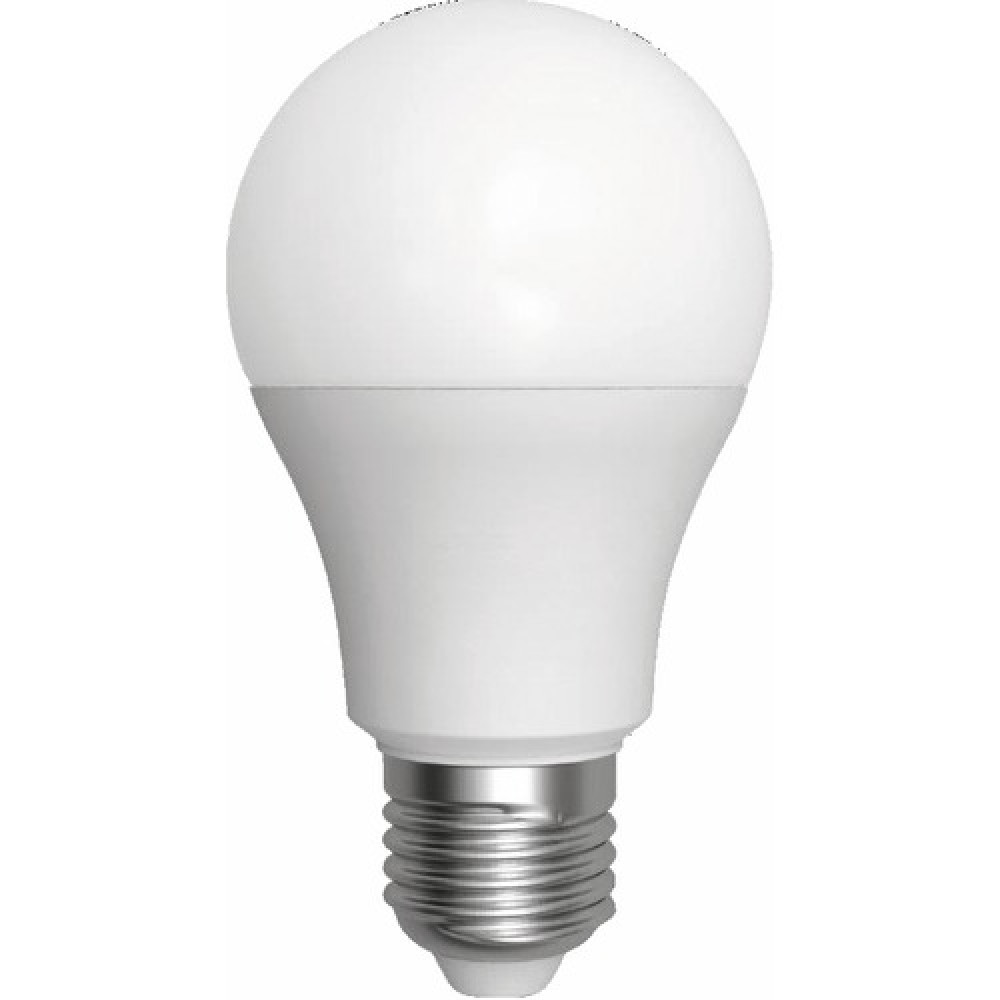

# LED Lamp PCB Design – T-Bulb

**OLITECH · Reproduction électronique et conception de circuits imprimés**

*Reproducing and designing an LED lamp electronic circuit with KiCad.*

---

**Brand / Marque:** OLITECH  
**Designer / Concepteur:** OLI OLI DONALD  
**Country / Pays:** Cameroon / Cameroun  
**Design software / Logiciel de conception:** KiCad EDA  
**Contact:** [oliolidonald186@gmail.com](mailto:oliolidonald186@gmail.com)

## Table of contents

- [Français](#-français)
  - [Présentation](#présentation)
  - [Architecture électronique](#architecture-électronique)
  - [Caractéristiques techniques](#caractéristiques-techniques)
  - [Travaux réalisés](#travaux-réalisés)
  - [Galerie du projet](#galerie-du-projet)
  - [État et limites du projet](#état-et-limites-du-projet)
  - [Avertissement de sécurité](#avertissement-de-sécurité)
  - [Fichiers du projet](#fichiers-du-projet)
- [English](#-english)
  - [Overview](#overview)
  - [Electronic architecture](#electronic-architecture)
  - [Technical specifications](#technical-specifications)
  - [Work completed](#work-completed)
  - [Project gallery](#project-gallery)
  - [Project status and limitations](#project-status-and-limitations)
  - [Safety warning](#safety-warning)
  - [Project files](#project-files)
- [Contact](#contact)

---

## 🇫🇷 Français

### Présentation

**LED Lamp PCB Design – T-Bulb** est un projet de reproduction du circuit électronique d'une lampe LED économique, avec conception des circuits imprimés sous **KiCad EDA**.

Le travail consiste à redessiner l'architecture électronique de la lampe et à concevoir les PCB correspondants, comprenant une carte d'alimentation et une carte destinée à recevoir les LED.

Le projet comprend également le routage des pistes et l'étude de la panélisation de plusieurs cartes.

Il s'agit d'un travail de reproduction et de conception électronique. La lampe n'a pas été fabriquée physiquement.

### Architecture électronique

Le système étudié repose sur deux ensembles complémentaires :

- **Carte d'alimentation (Driver) :** reproduction d'une alimentation capacitive sans transformateur, avec redressement par pont de diodes et filtrage.
- **Carte LED :** support d'une matrice circulaire composée de 18 LED SMD.

L'alimentation étudiée ne possède pas d'isolation galvanique entre le secteur et le circuit.

### Caractéristiques techniques

| Paramètre | Description |
|---|---|
| Application | Lampe LED économique de type T-Bulb |
| Logiciel de conception | KiCad EDA |
| Tension secteur cible | 220–240 V AC |
| Type d'alimentation étudiée | Capacitive, sans transformateur |
| Isolation galvanique | Absente |
| Redressement | Pont redresseur |
| Filtrage | Circuit de filtrage |
| Source lumineuse | 18 LED SMD |
| Disposition des LED | Matrice circulaire |
| Conception | Schéma et circuits imprimés |
| Routage PCB | Réalisé |
| Panélisation | Étude d'une configuration 12-en-1 |

### Travaux réalisés

- Reproduction du circuit électronique d'une lampe LED économique.
- Dessin et organisation des circuits sous KiCad.
- Conception des circuits imprimés.
- Routage des pistes.
- Préparation de configurations de panélisation.
- Étude d'un agencement de 12 cartes par panneau.

### Galerie du projet

La galerie présente les neuf images déposées dans le répertoire `images/` : une photographie illustrative montrant le type de lampe concerné, quatre vues avant des conceptions PCB et quatre vues arrière. Les vues avant et arrière permettent de comparer les deux faces des cartes. Elles documentent la conception sous KiCad et ne représentent pas un prototype physiquement fabriqué.

#### Aspect de la lampe LED

Photographie illustrative du type de lampe LED concerné — image de référence, et non photographie d'un prototype fabriqué dans le cadre de ce projet.

#### Vues avant des conceptions PCB

| Vue avant | Aperçu |
|---|---|
| Vue avant – carte LED |  |
| Vue avant – carte rectangulaire |  |
| Vue avant – panélisation 1 |  |
| Vue avant – panélisation 2 |  |

#### Vues arrière des conceptions PCB

| Vue arrière | Aperçu |
|---|---|
| Vue arrière – carte LED |  |
| Vue arrière – carte rectangulaire |  |
| Vue arrière – panélisation 1 |  |
| Vue arrière – panélisation 2 |  |

### État et limites du projet

| Élément | État |
|---|---|
| Reproduction du circuit électronique | Réalisée |
| Conception des PCB | Réalisée |
| Routage des pistes | Réalisé |
| Étude de panélisation | Réalisée |
| Fabrication physique | Non réalisée |
| Essais sur prototype physique | Non réalisés |
| Validation expérimentale | Non réalisée |

> **Important :** ce projet est actuellement au stade de conception numérique. Les images présentent les travaux de conception et de panélisation ; elles ne prouvent pas le fonctionnement électrique du circuit.

### Avertissement de sécurité

> **DANGER – TENSION SECTEUR 220–240 V AC**
>
> Le circuit étudié utilise une alimentation capacitive sans isolation galvanique. Certaines parties du circuit peuvent donc être portées à un potentiel électrique dangereux.
>
> Ne pas connecter une carte à une prise secteur et ne pas manipuler un circuit sous tension. Toute fabrication ou mise en service éventuelle nécessiterait une étude approfondie des protections électriques, des distances d'isolement, de la dissipation thermique et de l'enveloppe de protection, ainsi qu'une validation par une personne qualifiée.

### Fichiers du projet

Les fichiers sources KiCad (schéma et circuit imprimé) ne sont pas publiés dans ce dépôt. Le dépôt présente la documentation et les images du projet.

---

## 🇬🇧 English

### Overview

**LED Lamp PCB Design – T-Bulb** is a project focused on reproducing the electronic circuit of an energy-saving LED lamp and designing its printed circuit boards using **KiCad EDA**.

The work involves redrawing the lamp's electronic architecture and designing the corresponding PCBs, including a power supply board and a board designed to accommodate the LEDs.

The project also includes PCB track routing and a study of multi-board panelization.

This is an electronic reproduction and design project. The lamp has not been physically manufactured.

### Electronic architecture

The studied system is based on two complementary assemblies:

- **Power supply board (Driver):** reproduction of a transformerless capacitive power supply, including bridge rectification and filtering.
- **LED board:** support for a circular array of 18 SMD LEDs.

The studied power supply does not provide galvanic isolation between the mains and the circuit.

### Technical specifications

| Parameter | Description |
|---|---|
| Application | T-Bulb energy-saving LED lamp |
| Design software | KiCad EDA |
| Target mains voltage | 220–240 V AC |
| Studied power supply | Transformerless capacitive supply |
| Galvanic isolation | None |
| Rectification | Bridge rectifier |
| Filtering | Filtering circuit |
| Light source | 18 SMD LEDs |
| LED arrangement | Circular matrix |
| Design work | Schematic and PCB design |
| PCB routing | Completed |
| Panelization | 12-in-1 configuration study |

### Work completed

- Reproduction of an energy-saving LED lamp electronic circuit.
- Electronic drawing and organization using KiCad.
- Printed circuit board design.
- PCB track routing.
- Preparation of panelization configurations.
- Study of a 12-board-per-panel arrangement.

### Project gallery

The gallery contains all nine images uploaded to the `images/` directory: one illustrative photograph showing the type of LED lamp, four front views of the PCB designs, and four rear views. The front and rear views allow both sides of the boards to be compared. They document the KiCad design work and do not represent a physically manufactured prototype.

#### LED lamp appearance

Illustrative photograph of the LED lamp type — reference image, not a photograph of a prototype manufactured as part of this project.

#### Front views of the PCB designs

| Front view | Preview |
|---|---|
| Front view – LED board |  |
| Front view – rectangular board |  |
| Front view – panelization 1 |  |
| Front view – panelization 2 |  |

#### Rear views of the PCB designs

| Rear view | Preview |
|---|---|
| Rear view – LED board |  |
| Rear view – rectangular board |  |
| Rear view – panelization 1 |  |
| Rear view – panelization 2 |  |

### Project status and limitations

| Item | Status |
|---|---|
| Electronic circuit reproduction | Completed |
| PCB design | Completed |
| PCB track routing | Completed |
| Panelization study | Completed |
| Physical manufacturing | Not performed |
| Physical prototype testing | Not performed |
| Experimental validation | Not performed |

> **Important:** this project is currently at the digital design stage. The images show the design and panelization work; they do not demonstrate electrical operation of the circuit.

### Safety warning

> **DANGER – 220–240 V AC MAINS VOLTAGE**
>
> The studied circuit uses a capacitive power supply without galvanic isolation. Some parts of the circuit may therefore carry dangerous electrical potentials.
>
> Do not connect a board to a mains outlet or handle an energized circuit. Any potential manufacturing or commissioning would require a thorough assessment of electrical protection, insulation distances, thermal dissipation and protective enclosure design, as well as validation by a qualified professional.

### Project files

The KiCad source files (schematic and PCB layout) are not published in this repository. The repository presents the project documentation and images.

---

## Contact

**OLI OLI DONALD · OLITECH**  
Cameroon  
Email: [oliolidonald186@gmail.com](mailto:oliolidonald186@gmail.com)

*OLITECH — Electronic design and practical engineering.*
